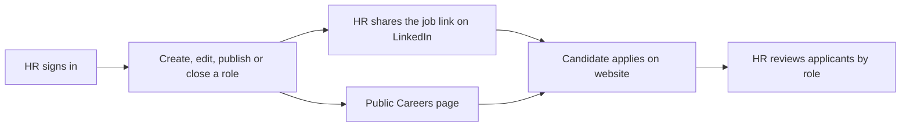

# Careers management — accepted approach

**Update, 18 October 2026:** The user approved the full HR dashboard. Website job publishing, private applications/CVs, staff authentication, review statuses, and export are implemented. See [the HR guide](hr-dashboard.md) and [architecture decision](careers-dashboard-architecture.md). The discovery discussion below is retained as the decision history; the operational guide supersedes its open implementation questions.

## User intent

Partt needs a Careers page whose openings can change without code edits. HR must be able to publish and close positions. There is no existing recruitment system. The user is comparing LinkedIn-driven listings with a website dashboard that also shows applicants.

## Recommendation for review

Use a protected website dashboard as the source for openings and applications. Share a role's public website URL in LinkedIn posts. Candidates complete the application on the website, so those submissions are available in the HR dashboard without a LinkedIn applicant-sync integration.

## Initial scope

- Public Careers page and individual job details using the current Partt design.
- Protected HR access; no public HR registration.
- Job lifecycle: draft, open, and closed. Only open roles are publicly available for application.
- Applications associated with the role, including contact details, CV, and an optional portfolio link.
- An HR applicant list with simple review statuses, such as new, reviewing, shortlisted, and closed.
- Closing a role removes it from open listings and prevents new website submissions for it; existing applicants remain available to HR.
- Candidate records and CVs are private to authorized HR users.
- Existing policy text must be updated to describe the actual application storage and handling once the implementation/storage arrangement is chosen.

The applicant-management scope is a proposal prompted by the user's question, not an implemented feature or an accepted final specification. No job titles, employment terms, or applicant records have been invented.

## LinkedIn distinction

Sharing a website job URL in a LinkedIn post sends interested candidates to the website. Applications submitted on the website can then be reviewed in its dashboard.

Applications submitted directly through LinkedIn do not reach a custom website dashboard merely because it links to or displays a job post. LinkedIn's documented Apply Connect application-delivery integration is for approved partners and requires provisioning/certification. See [Create and configure a customer application](https://learn.microsoft.com/en-us/linkedin/talent/apply-connect/create-configure-customer-application?view=li-lts-2026-04) and [Receive job applications](https://learn.microsoft.com/en-us/linkedin/talent/apply-connect/receive-applications?view=li-lts-2026-04).

Automatic LinkedIn posting/import or applicant synchronization is not assumed in the initial implementation.

## Implementation decisions still open

- Confirm whether the user wants website application collection and applicant statuses, or openings management with email applications only.
- Select authentication, persistent job/applicant storage, and private CV storage suitable for the intended hosting. The current project has none of these facilities.
- Confirm who receives HR access and how candidate retention will work.

Prefer an established authentication/content-management solution where it provides these needs without unnecessary custom infrastructure. No external account, service, database, or deployment has been created. Existing site source is unchanged during this decision discussion.
